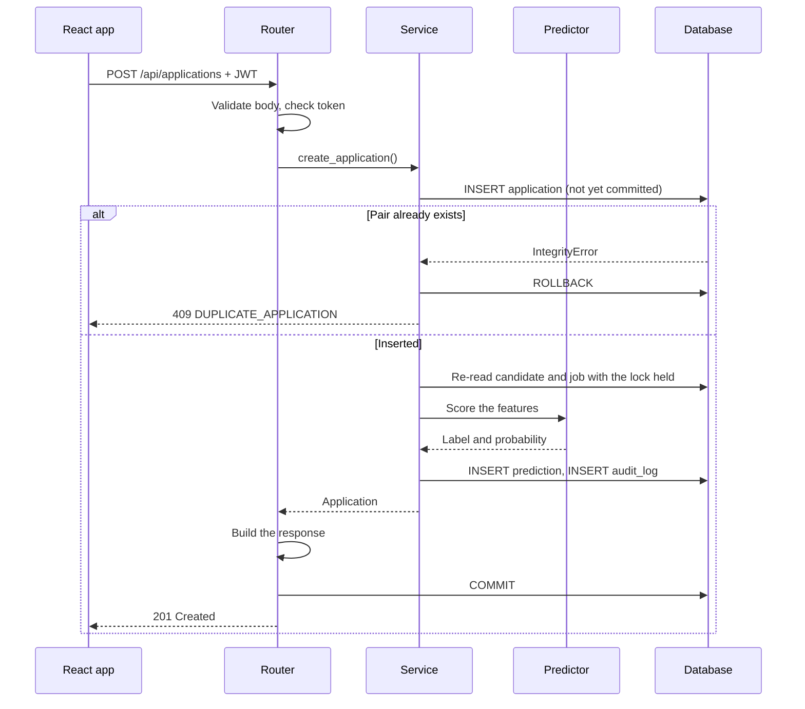

# Architecture

## Layers

| Layer | Location | Job |
|---|---|---|
| Routers | `backend/app/routers/` | Translate HTTP to service calls. No business logic |
| Services | `backend/app/services/` | All business rules and all writes |
| Models | `backend/app/models.py` | Tables and constraints |
| Schemas | `backend/app/schemas.py` | Request validation and response shapes |
| ML | `backend/app/ml/` | The shared feature function and the predictor |
| Scripts | `backend/scripts/` | Training, seeding, backup, restore and checks |

## Request flow

This is what happens when a recruiter creates an application.

Three details in that flow matter most:

1. **The commit happens before the response is sent.** `get_db` is declared with `scope="function"`. FastAPI's default
   runs the code after `yield` once the response has gone out, which could report success for a commit that then fails.
2. **Everything is one transaction.** The application, its prediction and its audit row are saved together or not at
   all. Any exception, anywhere in the request, rolls all of it back.
3. **The database is the referee.** There is no "does this exist?" check before the insert, because two simultaneous
   requests could both pass it. The unique constraint decides, and the loser gets a clean 409.

Status changes work the same way, and the `UPDATE` includes `WHERE version = ?`. If another request got there first, no
row matches and the client gets `409 STALE_UPDATE`. The frontend then reloads the row and shows "This record was
changed, please review."

## Startup sequence

`app/services/startup.py` runs these in order, and any failure stops the server with a clear error:

1. Make sure `storage/` exists.
2. Back up the database, if there is one.
3. Run `alembic upgrade head`.
4. Run `integrity_check` and `foreign_key_check`.
5. Recompute predictions that are missing or came from a different model version.

## Why training is offline

- **Different cost and rhythm.** Training does a cross-validated grid search, which is too slow for a web request, and
  it only needs to happen when the data or the approach changes.
- **The test set can only stay clean offline.** An evaluation is a deliberate one-off step. A live system that retrained
  itself could quietly start using data it was later judged on.
- **Reproducibility.** A training run is a script with fixed seeds, producing a versioned file that can be reviewed,
  committed and rolled back.
- **The API stays simple.** The server only loads a file and calls `predict_proba`. If the file is missing, the app keeps
  running and shows predictions as unavailable.

The two sides can't drift apart, because training and serving both call the same `build_features` function, and the saved
artifact records its column order. If the code and the artifact disagree, the predictor refuses to load the model.

## Why predictions are stored

Computing a prediction on every read would be simpler, but storing it is better here:

- **Performance.** The applications table shows 25 rows per page, and scoring each row on every read would run the forest
  once per page view. Reads stay cheap and never depend on the model being fast.
- **Filtering and auditing.** A stored prediction records what the model said, which version said it, and when. A value
  computed on read leaves no such record.
- **Availability.** It keeps the read path separate from the ML dependency.

The cost is that stored values can go stale, so three triggers keep them fresh:

| Trigger | What happens |
|---|---|
| Application created | Prediction computed in the same transaction |
| Candidate's skills or experience changed, or job's skills or minimum experience changed | Affected applications recomputed in the same transaction |
| Server starts with a different model version | All affected predictions recomputed before serving requests |

If the model is missing when inputs change, the now-wrong stored prediction is removed, and startup recomputes it once the
model is back. The API returns `null` with a message while no model is loaded.

## Frontend

- **Server state is in TanStack Query**, with no separate global store. `api/queryClient.ts` refreshes all data after any
  successful write, because one write can affect many screens.
- **`api/client.ts` is the only code that calls `fetch`.** It adds the token, turns error bodies into `ApiError`, and
  sends the user to login on a 401.
- **`QueryBoundary`** gives every query the same loading, error-with-retry and empty states.
- **Filters are in the URL** so a filtered view can be refreshed, bookmarked or shared.
