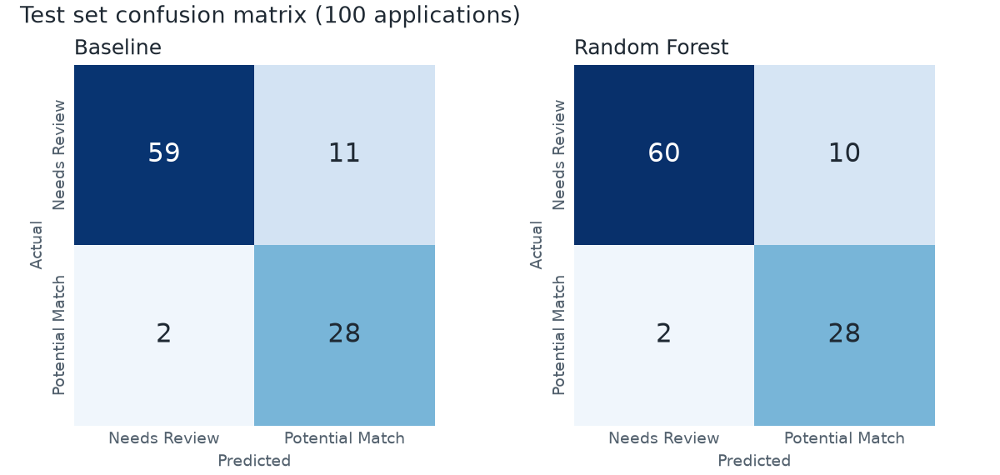

# Model report

All numbers below come from `backend/artifacts/metrics.json`, written by `python -m scripts.train`.

**Headline:** the chosen model (Random Forest) scores F1 0.824 on the test set against 0.812 for a one-line
skill-coverage rule. That gap is **one application out of 100**. The model is not meaningfully better than the
baseline on this data, and this report does not claim it is.

## Task

Predict `match_label` for a candidate-job pair: 1 is "Potential Match", 0 is "Needs Review". The labels are
synthetic and intentionally noisy. They are not hiring outcomes, and the prediction never changes an application's
status. Only a recruiter does that.

## Data

| | Train | Test |
|---|---|---|
| Candidates | 200 | 50 |
| Applications | 400 | 100 |
| Share of label 1 | 28.5% | 30.0% |

The split comes from `candidate_split.csv` and is asserted disjoint by candidate, so both of a candidate's
applications stay on the same side. Because the classes are imbalanced, F1 for class 1 is the metric. Always
predicting "Needs Review" would be about 70% accurate while finding no matches at all.

On training candidates, those with every required skill match 87.2% of the time and everyone else matches 20.7%.
Skill coverage is the main signal, which is why a simple baseline does so well.

## Features

`app/ml/features.py` holds one function, `build_features`, used by both training and serving so the two cannot drift.

| Feature | Meaning |
|---|---|
| `required_overlap_ratio` | Share of required skills the candidate has (1.0 if the job requires none) |
| `required_missing_count` | Number of required skills missing |
| `has_all_required` | 1 if no required skill is missing |
| `preferred_overlap_ratio` | Share of preferred skills the candidate has (0.0 if the job lists none) |
| `skill_jaccard` | Overlap between candidate skills and required ∪ preferred |
| `extra_skill_count` | Candidate skills the job did not ask for |
| `candidate_skill_count` | Total candidate skills |
| `experience_years` | Candidate experience |
| `min_experience_years` | Job's minimum experience |
| `experience_gap` | Experience minus the minimum |
| `meets_experience` | 1 if the candidate meets the minimum |

IDs, names, emails, `match_label`, `split`, recruiter status and stored predictions are excluded. A test enforces this.

## Approach

**Baseline:** predict 1 if `required_overlap_ratio >= t`. Each distinct ratio in the training set was tried as `t`,
and the highest training F1 won: **t = 0.667** (training F1 0.719). Requiring all skills (t = 1.0) scores only 0.509
because it misses too many matches, while t = 0.5 is nearly tied at 0.713. No test labels were used.

**Models:** both were tuned with `StratifiedGroupKFold(n_splits=5, shuffle=True, random_state=42)`, grouped by
candidate, on training data only, with `class_weight="balanced"` and the decision threshold fixed at 0.5.

| Model | Grid | Best parameters | Mean CV F1 | Std across folds |
|---|---|---|---|---|
| Random Forest | `n_estimators` {100, 300}, `min_samples_leaf` {1, 5, 10} | 300 trees, leaf 5 | **0.726** | 0.026 |
| Logistic Regression | `C` {0.01, 0.1, 1, 10} | C = 0.1 | 0.723 | 0.025 |

## Why this model

The rule fixed in advance was "highest mean CV F1", so Random Forest was selected. The honest reading is that this
is a tie: the 0.004 gap is far smaller than the 0.025 variation between folds. A fully grown forest
(`min_samples_leaf=1`) scored only 0.649 to 0.662, which suggests it was fitting label noise.

If the tie were broken on simplicity, Logistic Regression would be a reasonable choice. It is smaller and easier to
explain. It was not switched to after the fact, because that would mean changing the selection rule.

## Test results

Evaluated after the approach was final. Re-running the script is deterministic and gives the same numbers. No choice
was revisited after seeing them.

| | Precision | Recall | F1 |
|---|---|---|---|
| Baseline (ratio ≥ 0.667) | 0.718 | 0.933 | 0.812 |
| **Random Forest** | **0.737** | **0.933** | **0.824** |

| Confusion matrix | Actual 0, predicted 0 | Actual 0, predicted 1 | Actual 1, predicted 0 | Actual 1, predicted 1 |
|---|---|---|---|---|
| Baseline | 59 | 11 | 2 | 28 |
| Random Forest | 60 | 10 | 2 | 28 |

Both approaches find 28 of the 30 true matches. The model has one fewer false positive.

The test F1 (0.82) is higher than the CV F1 (0.73). That is most likely luck from a small test set with only 30
positives, so 0.73 is the more cautious estimate of what to expect.

## How a prediction is explained

The API returns the top 3 features behind a prediction. A logistic regression would use coefficient × scaled value,
but a random forest has no such coefficients. So each feature is replaced in turn with its training average, and the
contribution is how far the probability moves. This is per-candidate, unlike global feature importance. It is only
approximate: correlated features such as `required_overlap_ratio` and `has_all_required` can each stand in for the
other, which understates both.

## Limitations

- **Small, synthetic data.** 500 applications across 10 jobs. These scores measure recovery of an artificial pattern,
  not suitability for real recruitment.
- **Noisy labels.** Candidates with every required skill still get label 0 about 13% of the time, and no model can
  predict that noise.
- **The model barely beats a strong baseline**, because the labels are mostly driven by skill coverage. In production
  the one-line rule would deserve serious consideration.
- **No fairness testing is possible.** The data has no demographic attributes, and the data dictionary says not to
  infer them. Nothing here shows the model is fair.
- **Unseen jobs and skills.** Every job in the test set also appears in training. Features are ratios rather than skill
  identities, so a new job can be scored, but that behaviour has not been measured.
- **The threshold is global.** 0.5 is not tuned per job, and the balanced class weights mean the probability is a
  ranking signal rather than a calibrated chance of a match.
- **Experience has a weak effect** in this data, so the model should not be read as judging seniority.
